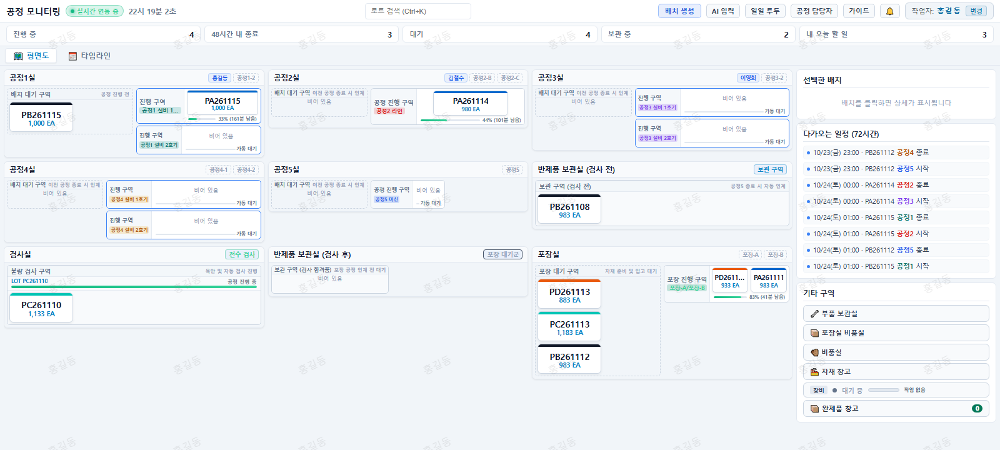
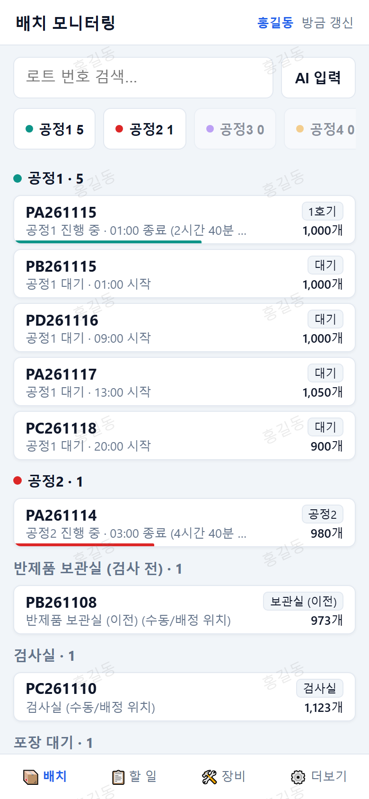
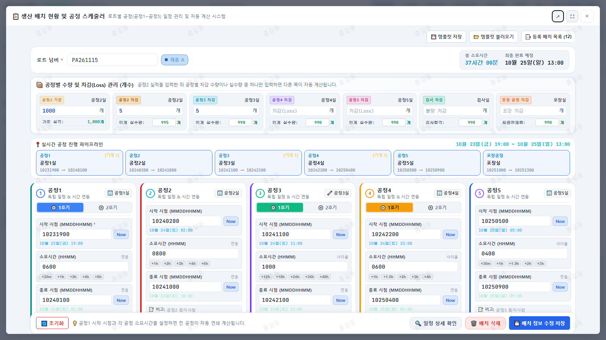
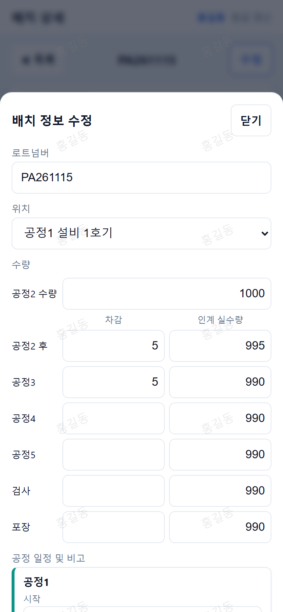
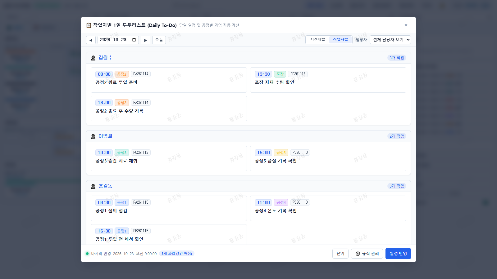
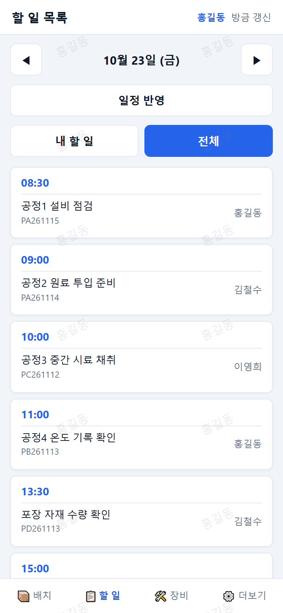
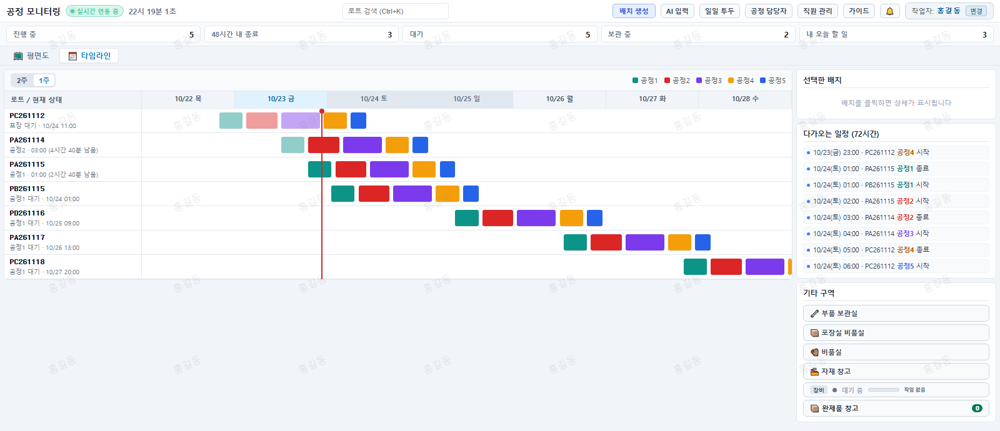

# 공정 모니터링 대시보드 (템플릿)

생산 현장의 배치(로트) 진행 상황을 평면도 위에 실시간으로 보여 주는 웹앱 템플릿입니다.
실제 생산 현장에서 직접 만들어 운영하던 시스템에서 회사 정보를 걷어 내고, 다른 현장에서도 쓸 수 있게 정리했습니다.
혼자서도 띄울 수 있는 가벼운 구조(Vite로 빌드한 정적 파일 + Supabase)로, 받아서 회사 공정에 맞게 고쳐 쓰는 것을 전제로 합니다.

*A PWA template (Vite + React + TypeScript + Supabase) for monitoring production batches on a factory floor plan, with daily to-dos, equipment booking and web push. Extracted from a system I built and ran on a real production floor.*

<p align="center"><b>① 메인 화면</b> — 공정실 평면도 위에 배치 위치와 진행률 표시</p>
<p align="center">
  
  
</p>

<p align="center"><b>② 배치 편집</b> — 공정 시작 시각·소요시간만 넣으면 뒤 공정이 자동 계산</p>
<p align="center">
  
  
</p>

<p align="center"><b>③ 할 일 목록</b> — 배치 일정에서 작업자별 할 일을 자동 생성</p>
<p align="center">
  
  
</p>

<p align="center"><b>④ 배치 스케줄</b> — 로트별 공정 일정을 시간 막대로 한눈에</p>
<p align="center">
  
</p>
<p align="center"><sub>더미 데이터 화면 · 왼쪽 PC, 오른쪽 휴대폰</sub></p>

> ## ⚠️ 먼저 읽어 주세요 — 보안
> 이 저장소의 보안 설정은 **"등록된 직원으로 로그인한 사용자만 읽고 쓴다"는 가장 기본적인 예시**뿐입니다.
> 회사 데이터를 넣기 전에 아래 [운영 전 보안 체크리스트](#운영-전-보안-체크리스트)를 보고 **회사 환경에 맞게 직접 보강**해 주세요.
> AI 코딩 도구에 이 README와 `supabase/schema.sql`을 함께 주고 "우리 회사 환경에 맞게 보안을 강화해 줘"라고 요청하는 것을 출발점으로 삼으면 됩니다.

## 주요 기능

| 기능 | 설명 |
|---|---|
| 평면도 모니터링 | 공정실(공정1 → 공정2 → 공정3 → 공정4 → 공정5 → 검사 → 포장)별 배치 아이콘, 진행률, 수량 게이지, 로트 검색 |
| 배치 등록·일정 | 로트별 공정 일정 입력, 앞 공정 시각으로 뒤 공정 자동 계산, 템플릿 저장 |
| 타임라인 | 배치별 공정 일정을 시간 막대로, 변경 기록(누가·언제·무엇을) |
| 선반·창고 화면 | 방마다 선반 칸에 물품을 끌어다 놓는 보관 현황판, 방 사이 물품 이동 |
| 장비 예약 | 예약 등록·겹침 검사, 시작·종료 알림 받을 사람 지정 |
| 공정 담당자 | 설비별 당일 담당자 편성(한 칸에 여러 명) |
| 일일 할 일 | 배치 일정 + 규칙으로 작업자별 할 일 자동 생성, 규칙은 화면에서 편집, 공휴일·주말 제외 |
| 웹 푸시 알림 | 할 일 5분 전 알림, 장비 예약 시작·종료 알림 (PC·안드로이드·아이폰 홈 화면 앱) |
| 모바일 화면 | 같은 주소를 휴대폰으로 열면 배치·할 일·장비·더보기 탭 화면 |
| AI 보고 입력 (선택) | 메신저 공정 보고를 붙여 넣으면 배치 수정안을 미리보기로 보여 주고, 사람이 확인한 줄만 적용 |
| 직원 관리 | 관리자가 직원 등록·삭제·관리자 지정 |
| 작업자 워터마크 | 화면에 로그인한 작업자 이름을 옅게 표시 (화면 캡처 유출 추적용) |

## 기술 스택

- 화면: [Vite](https://vite.dev) + React + TypeScript (멀티 페이지 PWA). PC 화면과 모바일 화면이 같은 계산 코드(`src/batch/` 등)를 쓴다. `supabase-js`는 CDN(버전·무결성 고정)으로 불러온다
- 스타일: 일반 CSS (`css/`)
- 서버: [Supabase](https://supabase.com) — Postgres, 행 단위 권한(RLS), DB 함수(RPC), Edge Functions(Deno/TypeScript), Auth, Realtime, Vault, pg_cron
- 배포: `npm run build`가 만든 `dist/`를 정적 호스팅 아무 곳에 (예: Vercel. `vercel.json`이 빌드 명령·`dist`·기본 보안 헤더를 정한다)
- 알림: Web Push (VAPID)
- AI(선택): Google Gemini Decision API — 글을 쓰게 하지 않고 정해진 보기 중에서 고르게만 한다
- 테스트: 타입 검사(`tsc`) + Node 내장 테스트(`node --test`) + Python Playwright E2E. GitHub에 올리면 `.github/workflows/test.yml`이 같은 테스트를 돌린다

## 설치

### 1. Supabase 프로젝트
1. Supabase에서 새 프로젝트를 만듭니다.
2. **SQL Editor**에서 `supabase/schema.sql`을 통째로 실행합니다.
3. **Authentication → Sign In / Providers**에서 이메일 로그인을 켜고, **"Allow new users to sign up"은 끕니다** (직원 계정은 관리자가 만든다).
4. **Authentication → Users → Add user**로 첫 관리자 계정(이메일·비밀번호)을 만듭니다.
5. SQL Editor에서 같은 이메일로 첫 관리자를 등록합니다.
   ```sql
   INSERT INTO public.workers (name, email, is_admin, is_owner) VALUES ('관리자', 'admin@example.com', true, true);
   ```
6. 이후 직원은 앱의 **[직원 관리]**에서 이름·부서·이메일로 등록하고, 같은 이메일로 Authentication에서 계정을 만들어 줍니다.

### 2. 연결 설정
[Node.js](https://nodejs.org) 22 이상을 설치하고 `npm install`로 개발 도구를 받습니다.

`src/config.ts` 한 파일만 고칩니다 (서비스 워커용 `js/config.js`는 빌드할 때 이 값으로 자동 생성됩니다).
```ts
export const SUPABASE_URL = 'https://<프로젝트 ref>.supabase.co';
export const SUPABASE_KEY = '<publishable(anon) 키>';
export const VAPID_PUBLIC_KEY = '<웹 푸시 공개 키>';
```
여기에는 브라우저에 공개되어도 되는 값만 둡니다. **서비스 키·AI 키는 절대 넣지 않습니다.**

### 3. 웹 푸시 알림 (선택)
1. 키 만들기: `npx web-push generate-vapid-keys`
2. 공개 키는 `src/config.ts`에, 비밀 키는 Vault에 넣습니다 (SQL Editor).
   ```sql
   SELECT vault.create_secret('<무작위 긴 문자열>', 'push_cron_secret');
   SELECT vault.create_secret('<VAPID 공개 키>', 'vapid_public_key');
   SELECT vault.create_secret('<VAPID 비밀 키>', 'vapid_private_key');
   SELECT vault.create_secret('mailto:<연락처 이메일>', 'vapid_subject');
   SELECT vault.create_secret('https://<프로젝트 ref>.supabase.co', 'project_url');
   ```
3. 함수 배포: `supabase functions deploy todo-push --no-verify-jwt`
   (DB 예약 작업이 Vault의 `push_cron_secret`을 헤더로 붙여 부르고, 함수는 그 값으로 요청을 확인합니다)

### 4. AI 보고 입력 (선택)
1. **학습에 쓰이지 않는 유료 등급**의 Gemini API 키를 준비합니다.
2. `supabase secrets set GEMINI_API_KEY=<키>` — 키는 서버 비밀 저장소에만 둡니다.
3. `supabase functions deploy batch-assist`
4. 쓰지 않으려면 아래 [AI 입력 기능 빼기](#ai-입력-기능-빼기)를 따릅니다.

### 5. 실행·배포
- 개발: `npm run dev` (Vite 개발 서버)
- 배포: `npm run build`로 만든 `dist/` 폴더만 배포합니다. Vercel은 `vercel.json` 설정대로 알아서 빌드합니다. 다른 곳에 올릴 때도 `dist/`만 올립니다 (소스·문서·SQL은 공개하지 않는다).

## 회사에 맞게 고치기

| 바꿀 것 | 위치 |
|---|---|
| 앱 이름 | `index.html`의 `<title>`·헤더, `manifest.webmanifest`, 새 창 화면 `sub_*/Index.html`의 `<title>` |
| 평면도(방 배치·설비 수) | `src/main/Floorplan.tsx`의 `ROOMS`, 구역 목록 `src/batch/zone.ts`의 `ZONES`, `css/main.css` |
| 공정 이름 | `src/batch/core.ts`·`src/main/summary.ts`의 `STEP_NAMES`, `src/batch/zone.ts`, `supabase/functions/batch-assist/rules.mjs`, 화면 글자 |
| 제품군 색상(로트 머리글자 → 제품) | `src/batch/lot.ts`의 `productLine` |
| 같은 구역 안 배치 정렬 | `src/batch/lot.ts`의 `compareLots` |
| 설비별 담당 칸 | `src/todo/core.ts`의 `ROLE_MAP`, `src/pm/managers.ts`의 `PM_LABELS`, `process_managers` 표 |
| 기본 할 일 규칙(예시) | `src/todo/core.ts`의 `DEFAULT_RULES` — 실제 규칙은 화면 [⚙️ 규칙 관리]에서 만들면 DB에 저장됩니다 |
| 공휴일·휴무일 | `supabase/schema.sql`의 공휴일 예시 행 (`todo_schedules`의 `HOLIDAY`) |
| 선반·창고 화면의 방·칸·기본 물품 | `src/rooms/rooms.ts`(방 목록·제목), `src/rooms/shelf/defaults/*.json`(선반 기본 배치), `src/rooms/warehouse/model.ts`(창고) |
| AI가 읽을 회사 보고 규칙 | `supabase/functions/batch-assist/decide.mjs`의 `CUSTOM_DEDUCT_RULES`, 로트 줄임말 등은 `extract.mjs`의 `takeLots` |

화면 코드는 `src/` 아래 기능별 폴더에 있습니다: `main/`(PC 메인 화면·로그인), `mobile/`(휴대폰 화면), `batch/`(배치 계산·저장, PC·모바일 공용), `batches/`(배치 등록 창), `todo/`(할 일), `equipment/`(장비 예약), `pm/`(공정 담당자), `rooms/`(선반·창고), `push/`(웹 푸시), `admin/`(직원 관리).

## 운영 전 보안 체크리스트

템플릿이 해 주지 않는 것들입니다. 회사 환경에 맞는 방식은 직접 정해 구현하세요.

- [ ] **접속 범위 제한** — 사내 네트워크·VPN·SSO 등 회사가 허용한 경로에서만 열리게 합니다. 화면 쪽 검사만으로는 막을 수 없으니 서버(DB·함수) 쪽에서 검사합니다.
- [ ] **서버 쪽 권한 검사** — 모든 표와 함수의 권한을 DB(RLS, 함수 안 검사)에서 확인합니다. 화면에서 버튼을 숨기는 것은 권한이 아닙니다. `SECURITY DEFINER` 함수는 안에서 호출자를 직접 확인합니다.
- [ ] **로그인 실패 제한** — 틀린 로그인 반복을 제한하고, 이상한 시도가 있으면 관리자가 알 수 있게 합니다.
- [ ] **계정 관리** — 가입은 막고 관리자가 계정을 만듭니다. 퇴사자는 직원 표와 로그인 계정을 함께 지웁니다. 비밀번호 정책과 다단계 인증을 검토합니다.
- [ ] **기록** — 누가 언제 무엇을 바꿨는지, 로그인 성공·실패를 남기고, 기록 자체는 일반 사용자가 고치거나 지울 수 없게 합니다.
- [ ] **중요 데이터 삭제 방지** — 배치처럼 잃으면 안 되는 데이터는 지우기 대신 상태 변경을 쓰거나 삭제 권한을 막고, 백업을 확인합니다.
- [ ] **비밀 키 서버 보관** — 서비스 키·AI 키·푸시 비밀 키는 서버 비밀 저장소(Edge Function Secrets, Vault)에만 둡니다. 저장소·화면 코드·채팅에 붙여 넣지 않습니다.
- [ ] **입력 값 검사** — 화면에 그리는 DB 값은 이스케이프하고, 서버 함수는 받는 값의 길이·형식을 검사합니다.
- [ ] **점검** — Supabase 대시보드의 Security Advisor 경고를 확인하고, 주기적으로 권한을 다시 봅니다.

## 데이터 유출 방지 팁

AI와 웹 서비스를 회사 업무에 쓸 때 지킨 원칙들입니다.

- **AI는 학습에 쓰이지 않는 유료 등급으로.** 무료 등급은 입력이 학습에 쓰일 수 있습니다. 키는 서버 비밀 저장소에만 둡니다.
- **AI에는 필요한 글만 보내고, 결과는 사람이 확인한 뒤 적용합니다.** 이 템플릿의 AI 입력은 보고 원문과 로트 이름만 보내고, AI가 지어낸 글은 화면에 닿지 못하게(원문 조각만 통과) 검사하며, 미리보기에서 체크한 줄만 저장합니다.
- **화면에 작업자 이름 워터마크.** 캡처가 밖으로 나가도 누구 화면인지 알 수 있게 합니다.
- **회사 네트워크에서만 접속.** 위 체크리스트의 접속 범위 제한을 꼭 구현합니다.
- **변경·로그인 기록을 남깁니다.**
- **중요 데이터는 지우지 못하게 합니다.**
- **개인 키와 회사 자원을 분리합니다.** 개인 명의 키·계정으로 만든 기능은 퇴사할 때 바로 끌 수 있게(키만 해지하면 기능이 꺼지게) 설계합니다.

## 테스트

```bash
npm install              # 처음 한 번
pip install playwright   # 처음 한 번
python -m playwright install chromium
npm test                 # = node scripts/run-tests.js
```
타입 검사와 빌드를 먼저 하고, 단위 테스트(`tests/*.test.js`)와 E2E 러너(`tests/e2e/qa_runner_*.py`)를 함께 돌립니다. E2E는 빌드 결과(`dist/`)를 띄우고 Supabase 요청을 모두 가짜로 답하므로 실제 프로젝트가 없어도 됩니다. 러너 하나만 돌릴 때는 먼저 `npm run build`를 합니다.

## AI 입력 기능 빼기

1. 삭제: `js/ai_input/`, `supabase/functions/batch-assist/`, `tests/batch_assist_*`, `tests/fixtures/batch_assist/`, `tests/e2e/qa_runner_batch_assist.py`
2. `index.html`의 `<!-- AI 입력 기능 ... -->` 블록(주석 + script 2줄)과 `scripts/run-tests.js` `E2E_RUNNERS`의 `'qa_runner_batch_assist.py'` 삭제
3. `supabase/schema.sql`의 "AI 입력 해석 기록" 절(`assist_log`, `flag_assist_log`) 삭제
4. `node scripts/run-tests.js`

## 라이선스

[Apache License 2.0](LICENSE)
